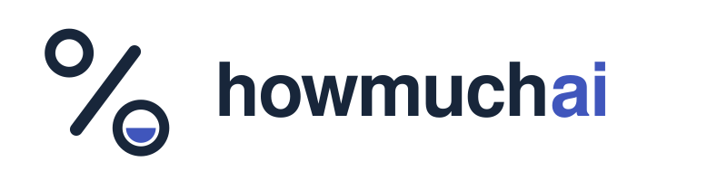

<p align="center"></p>

<h3 align="center">这个仓库有多少是 AI 写的？</h3>

<p align="center">输入任意公开的 GitHub 仓库，howmuchai 会读取最近的 commit 和 pull request，统计其中带有 AI 编程助手签名的比例：Claude Code、Copilot、Codex、Cursor、Devin、Jules、Aider 等。每一条匹配都链接到对应的 commit。</p>

<p align="center"><a href="https://maximilianfeix.github.io/howmuchai/"><b>在线试用</b></a> · <a href="https://maximilianfeix.github.io/howmuchai/leaderboard/"><b>Top 1000 仓库排行榜</b></a> · <a href="README.md">English</a></p>

## 用法

```sh
npx github:maximilianfeix/howmuchai vercel/next.js
```

网页版：<https://maximilianfeix.github.io/howmuchai/>（在浏览器中直接调用 GitHub API，无服务器、无追踪）。

## 统计方法

howmuchai 不猜测，也不使用 AI 检测模型，只统计**公开声明**的签名：

- commit trailer，例如 `Co-authored-by: Claude … <noreply@anthropic.com>`、`Co-authored-by: Copilot …`、`… (Codex)`、`Cursor Agent <cursoragent@cursor.com>`
- 机器人作者，例如 `copilot-swe-agent[bot]`、`devin-ai-integration[bot]`、`google-labs-jules[bot]`、`claude[bot]`
- 页脚，例如 `🤖 Generated with Claude Code`
- PR 分支前缀（中等置信度），例如 `codex/`、`cursor/`、`claude/`

统计范围：默认分支最近 90 天，最多 500 个 commit 和 300 个 PR；不计 merge commit 和依赖更新机器人。

**这是下限。** 签名可以被关闭，squash merge 可能丢失签名，从聊天窗口复制的代码不会留下痕迹。"未发现签名"不代表是人写的。

## README 徽章

```markdown
[](https://maximilianfeix.github.io/howmuchai/r/OWNER/REPO/)
```

也可以使用 GitHub Action：`uses: maximilianfeix/howmuchai@v0`，详见 [英文 README](README.md#github-action)。

MIT 许可证。
